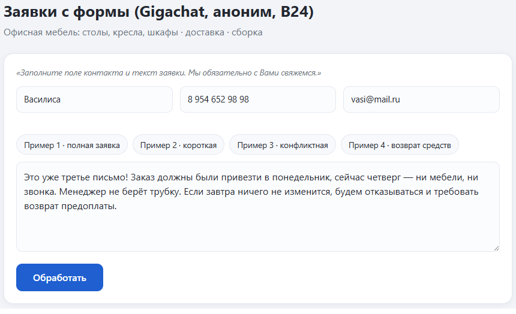
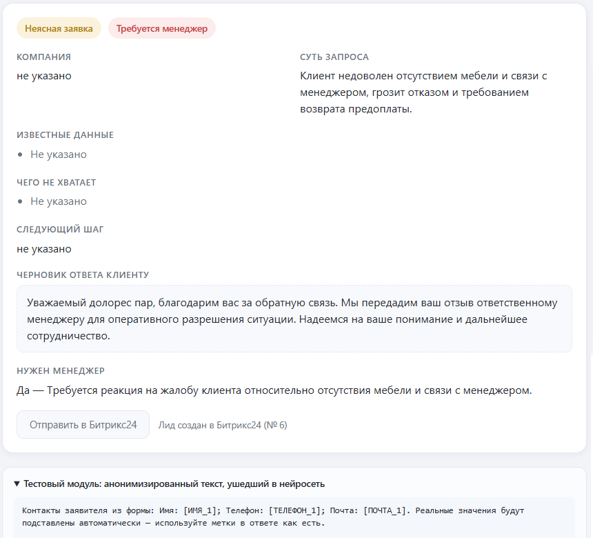
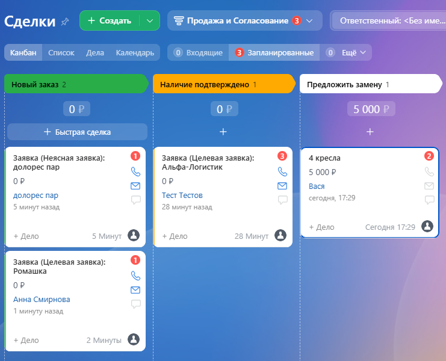

# Заявки с формы — ИИ-ассистент обработки входящих заявок (GigaChat + Битрикс24)

*Веб-приложение, в котором нейросеть GigaChat обрабатывает заявку и передаёт менеджеру
структурированную карточку заявки в CRM Битрикс24 со статусом в работе*

---

## ⚙️ Основная функция

Менеджер вставляет текст заявки вместе с контактами (имя, телефон, почта)
и нажимает «Обработать». Сервис:

1. Проверяет контакты на странице и повторно на сервере (защита от обхода формы).
2. **Анонимизирует персональные данные** — телефоны, почты, имена, адреса, ИНН, СНИЛС,
3. Отправляет текст в **GigaChat API** по строгой инструкции (промпт) и получает
   структурированный ответ (JSON), повторный запрос при сбое формата выполняется автоматически.
4. Проверяет и чистит ответ: обязательные поля, допустимые значения, запреты
   на «придумывание» данных и обещания цен или сроков.
5. Показывает результат карточкой на русском языке.
6. По кнопке (или автоматически) создаёт **лид в Битрикс24** через вебхук `crm.lead.add`:
   контакты — в стандартные поля, весь разбор ИИ — в комментарий.

**Форма заявки** — контакты, кнопки с примерами, текст заявки:

**Карточка разбора заявки** нейросетью — тип, суть, недостающие данные, черновик ответа,
флаг «Нужен менеджер» и статус отправки в Битрикс24:

**Результат в Битрикс24** — заявки автоматически попадают в канбан лидов/сделок:

## Как устроена квалификация (для понимания)

- **Целевая** — про мебель/доставку/сборку и есть намерение купить или заказать.
- **Нецелевая** — не про продукты и услуги компании (реклама, спам, чужие темы).
- **Неясная** — данных мало для уверенного ответа.
- Жалобы, конфликты, угрозы ухода, требования возврата — помечается «Требуется менеджер»,
  черновик ответа в этом случае нейтральный, без обещаний цен и сроков.
- Модель не выдумывает данные: чего-то нет — пишет «не указано» и добавляет в «Чего не хватает».

## 🛠 Технологии

| Слой | Технология |
|---|---|
| Язык | **Python 3.12** |
| Серверная часть | **Flask** — маршруты `/`, `/api/process`, `/api/bitrix/send` |
| Нейросеть | **GigaChat API** от Сбера через официальный пакет `gigachat` (автообновляемая OAuth-авторизация) |
| Конфигурация | `python-dotenv`, файл `.env` (секреты не попадают в git) |
| CRM | **Битрикс24** — входящий вебхук, REST-метод `crm.lead.add` |
| Frontend | **HTML + CSS + чистый JavaScript** (без фреймворков), адаптивная вёрстка |
| Безопасность | Анонимизация ПДн по правилам-шаблонам (regex), проверка SSL-сертификатов НУЦ Минцифры |
